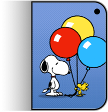

# kidcue

<p align="center"></p>

Kid Cue (internal name *ShutterBuddy*) assets extracted from iPhone19,4 iOS 27.2 (24B91020). 

## Contents

- `raw_assets/` – the 15 Snoopy `.heics` animations and `shutterbuddy_bg_template.png` (from `Camera.app/ShutterBuddy_Assets`)
- `source/CameraUI_Assets.car` – CameraUI asset catalog (contains `kidque_icon`)
- `gifs/` – 512px transparent looping GIFs (12 fps), made with ffmpeg from the HEVC colour + alpha tracks
- `composited/` – all 15 animations over a recreated background
- `icon/`, `background/` – see below

## Background texture

Kid Cue plays Snoopy animations (transparent) over a generated background. The app takes
`shutterbuddy_bg_template.png` (82x2160, a vertical halftone gradient: tiny dots at the top, solid
black at the bottom) and false-colors it with `CIFalseColor` (black -> dark colour, white -> light colour).
`background/make_background.py` recreates it:

```bash
python3 background/make_background.py out.png 1024 1024 '#4678BA' '#7D9EDF'
```

The colours are Apple's real palette, decoded from the `CameraUI` binary (`background/colorways.json`).
`ShutterBuddyMediaManager` builds 13 named `BackgroundColorway`s, each with a `bg` and a `dot` colour, and logs
"Picked session colorway" when it chooses one per session. White in the template becomes `bg`, black becomes `dot`.

| colorway | bg | dot | | colorway | bg | dot |
|---|---|---|---|---|---|---|
| beach | `#73BABD` | `#418BA1` | | peppermint | `#ACD98D` | `#7FB783` |
| blanket | `#7A9BDE` | `#4677BB` | | pumpkin | `#FFAB70` | `#E47956` |
| campfire | `#EC8580` | `#D96155` | | scout | `#7C7992` | `#36927B` |
| doghouse | `#E65E68` | `#B94356` | | sunset | `#CF80AE` | `#CF5683` |
| lucyblue | `#6982D9` | `#495EAE` | | violet | `#8080B6` | `#575AA0` |
| lunar | `#B199DB` | `#7C70B8` | | woodstock | `#EFCE80` | `#E49F4E` |
| newspaper | `#E4E4E4` | `#B6B6B6` | | | | |

`blanket` matches the `shutterbuddy_menu_content` image from the asset catalog. Swatches are in `background/swatches/`.
Dot pitch of my recreation is approximate. The pairing of animation to colorway in `composited/` is my own,
for demo purposes only, since the app picks a colorway per session.

`composited/` has all 15 animations over backgrounds (`python3 background/compose_all.py` regenerates them).
